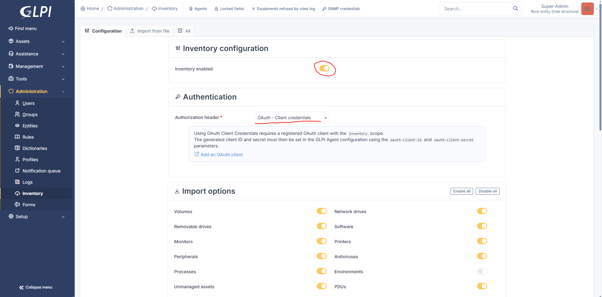
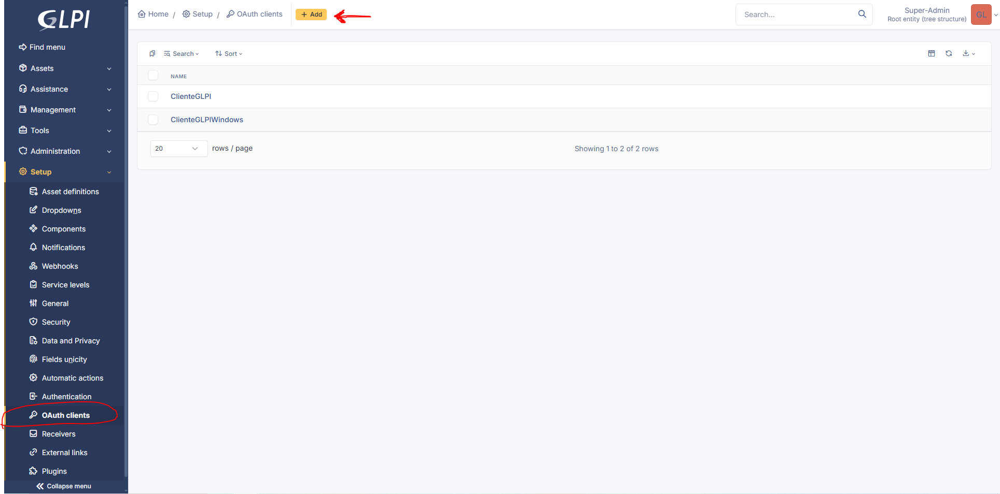
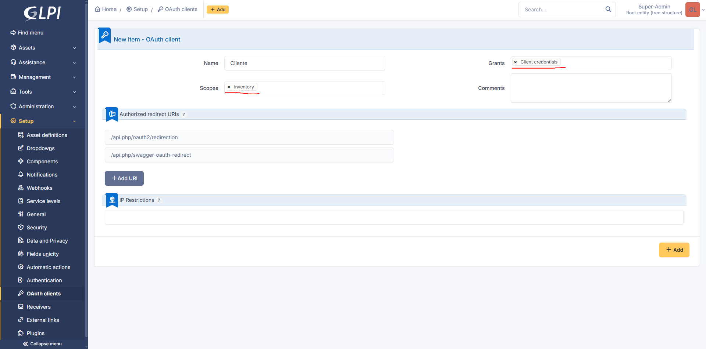
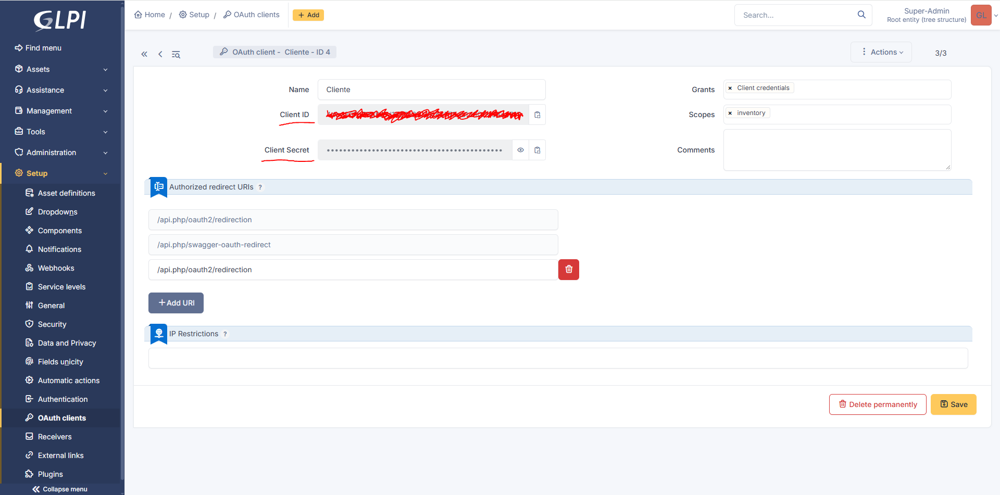

# GLPI-Install-Guide
Guía para la instalacion de un servidor GLPI y un agente simple en Ubuntu Server.

## ÍNDICE
- [GLPI HTTP Web](#http)
- [GLPI HTTPS Web (OPCIONAL)](#https)

  
- [Primeros pasos](#primeros-pasos)
- [Instalación y configuración docker](#instalación-y-configuracion-docker)
- [Configuración de los contenedores](#configuración-de-los-contenedores)
- [Inicio de los contenedores](#inicio-de-los-contenedores)
- [Instalación de un agente glpi en otro servidor](#instalación-de-un-agente-glpi-en-otro-servidor)
- [Pasos finales para el servidor](#pasos-finales-para-el-servidor)


## Primeros pasos

Para que no haya fallos en la conexión de la máquina, recomiendo permitir los siguiente puertos en el firewall **tanto en el servidor como en el cliente**:

```bash
# En el servidor
sudo ufw allow 3306/tcp comment "MariaDB"         
sudo ufw allow 8080/tcp comment "GLPI Server"
sudo ufw allow 2222/tcp comment "SSH ( OPCIONAL )"

#En el cliente
sudo ufw allow 8080/tcp comment "GLPI Server"
sudo ufw allow 2222/tcp comment "SSH ( OPCIONAL )"ç
sudo ufw allow 62354/tcp comment "GLPI Agent ( OPCIONAL )"   # Solo si vas a forzar inventario desde la web del servidor.

sudo ufw reload
```

## Instalación y configuracion docker

Primero instalaremos docker-engine y docker-compose. Para ello, primero añadimos el repositorio oficial de docker mediante este script:

```nano
#!bin/bash

# Add Docker's official GPG key:
sudo apt update
sudo apt install ca-certificates curl
sudo install -m 0755 -d /etc/apt/keyrings
sudo curl -fsSL https://download.docker.com/linux/ubuntu/gpg -o /etc/apt/keyrings/docker.asc
sudo chmod a+r /etc/apt/keyrings/docker.asc

# Add the repository to Apt sources:
sudo tee /etc/apt/sources.list.d/docker.sources <<EOF
Types: deb
URIs: https://download.docker.com/linux/ubuntu
Suites: $(. /etc/os-release && echo "${UBUNTU_CODENAME:-$VERSION_CODENAME}")
Components: stable
Architectures: $(dpkg --print-architecture)
Signed-By: /etc/apt/keyrings/docker.asc
EOF

sudo apt update
```

Después, instalamos docker con el siguiente comando:

```bash
sudo apt install docker-ce docker-ce-cli containerd.io docker-buildx-plugin docker-compose-plugin
```

Ahora añadimos el usuario principal al grupo de docker para poder ejecutar docker sin sudo:

```bash
sudo usermod -aG docker TUUSUARIO
```
Hay que reiniciar la maquina para guardar los cambios.

### HTTP

## Configuración de los contenedores

Vamos a configurar los contenedores para que se comuniquen entre si.

Creamos un directorio de trabajo para el contenedor ( en mi caso GLPI ):

```bash
mkdir GLPI
```
Dentro del directorio creamos 2 archivos, .venv y docker-compose.yml:

```bash
cd GLPI
touch .env
touch docker-compose.yml
```

- .venv --> Sera el archivo que contenga las variables para acceder tanto a GPLI como a la BBD. ( host, puerto, contraseña,nombre de la BBDD, contraseña root de la BBDD...) El contenido sería este:

```nano
GLPI_DB_HOST=mariadb
GLPI_DB_PORT=3306
GLPI_DB_NAME=glpi
GLPI_DB_USER=glpi
GLPI_DB_PASSWORD=glpi
GLPI_DB_ROOT_PASSWORD=mariadb
# Usar contraseñas robustas
```

Cambiamos los permisos para que solo el propietario pueda acceder, ya que tiene contraseñas:

```bash
chmod 600 .env
```

- docker-compose.yml --> Este archivo contendrá las configuraciones del servidor GLPI y la BBDD. El contenido sería este:

```yaml
name: glpi

services:
  glpi:
    image: "glpi/glpi:latest"
    restart: "unless-stopped"
    container_name: glpi
    hostname: glpi
    volumes:
      - data:/var/glpi                  # Directorio donde se guardará los archivos de glpi
    env_file: .env                      # el fichero creado anteriormente con las varibles
    depends_on:
      - mariadb
    ports:
      - "8080:80"                       #  Puerto externo ( el que escuchará la maquina host ) : Puerto interno que utilzará docker

  mariadb:
    image: "mariadb:lts-ubi10"
    restart: "unless-stopped"
    container_name: mariadb
    hostname: mariadb
    volumes:                            
      - mariadb_data:/var/lib/mysql     # Directorio donde se guardará la BBDD
    environment:                        # Variables de la BBDD usando las declaradas en el archivo .env
      MARIADB_ROOT_PASSWORD: ${GLPI_DB_ROOT_PASSWORD}
      MARIADB_DATABASE: ${GLPI_DB_NAME}
      MARIADB_USER: ${GLPI_DB_USER}
      MARIADB_PASSWORD: ${GLPI_DB_PASSWORD}

volumes:
  data:
  mariadb_data:
```

Físicamente los volúmenes en el sistema se encuentran en **/var/lib/docker/volumes/**.

## Inicio de los contenedores

Ya con las imágenes y los archivos de configuración, simplemente ejecutamos el siguiente comando en el directorio de trabajo:

```bash
docker compose up -d
```
Deberia imprimir esta salida:

```bash
[+] up 2/2
 ✔ Container mariadb Started                                                                                                                0.2s
 ✔ Container glpi    Started                                                                                                                0.4s
```

Además, si ejecutamos el siguiente comando debería aparacer esto:

```bash
asrc@ServerGLPI:~/GLPI$ docker compose ps
NAME      IMAGE               COMMAND                  SERVICE   CREATED        STATUS          PORTS
glpi      glpi/glpi:latest    "/opt/glpi/entrypoin…"   glpi      45 hours ago   Up 13 seconds   0.0.0.0:8080->80/tcp, [::]:8080->80/tcp
mariadb   mariadb:lts-ubi10   "docker-entrypoint.s…"   mariadb   45 hours ago   Up 13 seconds   3306/tcp
```

Con esto debería estar funcionando correctamente GLPI. Desde otra maquina en la misma red, entra en un navegador con la siguiente url:

```nano
http://IPDETUSERVIDOR:8080/
# El puerto puedes cambiarlo en el archivo docker-compose.yml.
```

Debería aparecer la web de glpi. El usuario y contraseña por defecto son:

```nano
usuario: glpi
contraseña: glpi
```

### HTTPS

GLPI por defecto no soporta HTTPS, pero podemos implementarlo utilizando nginx como proxy web ( ESTO ES OPCIONAL, PUEDES SALTARTELO ):

Primero conseguimos los certificados deseados cert.pem y key.pem. Si el certificado es de una entidad, te darán un archivo empaquetado con el par de claves (.p12 o .pfx ). Para extraerlas haz lo siguiente:

```bash
# Extraer la clave privada (key.pem)
openssl pkcs12 -in certificado.p12 -nocerts -out key.pem -nodes

# Extraer el certificado público (cert.pem)
openssl pkcs12 -in certificado.p12 -clcerts -nokeys -out cert.pem
```

Si por el contrario lo quieres autofirmado, el comando para generarlas es el siguiente:

```bash
openssl req -x509 -newkey rsa:2048 -keyout etc/key.pem -out etc/cert.pem -days 3650 -sha256 -nodes -subj "/CN=127.0.0.1"
```

Después, creamos un archivo de configuración para el proxy llamado nginx.conf con este contenido:

```nano
server {
    listen 443 ssl;
    server_name localhost;

    ssl_certificate /etc/nginx/certs/cert.pem;
    ssl_certificate_key /etc/nginx/certs/key.pem;

    location /plugins/hidecomputertabs/ {
        alias /var/www/glpi/plugins/hidecomputertabs/;
    }

    location / {
        proxy_pass http://glpi:80;
        proxy_set_header Host $host;
        proxy_set_header X-Real-IP $remote_addr;
        proxy_set_header X-Forwarded-For $proxy_add_x_forwarded_for;
        proxy_set_header X-Forwarded-Proto https;
    }
}

```
Deberia quedar estructurado asi:

```bash

``

Una vez con el par de claves y el archivo de configuración, el contenido de docker-compose.yml cambiaría a esto:

```yaml
name: glpi

services:
  glpi:
    image: "glpi/glpi:latest"
    restart: "unless-stopped"
    container_name: glpi
    hostname: glpi
    volumes:
      - data:/var/glpi
    env_file: .env
    depends_on:
      - mariadb
    ports:
      - "8080:80"

  web-proxy:
    image: nginx:alpine
    restart: "unless-stopped"
    container_name: web-proxy
    ports:
      - "443:443"
    volumes:
      - ./nginx.conf:/etc/nginx/conf.d/default.conf:ro
      - ./ssl/cert.pem:/etc/nginx/certs/cert.pem:ro
      - ./ssl/key.pem:/etc/nginx/certs/key.pem:ro
    depends_on:
      - glpi

  mariadb:
    image: "mariadb:lts-ubi10"
    restart: "unless-stopped"
    container_name: mariadb
    hostname: mariadb
    volumes:
      - mariadb_data:/var/lib/mysql
    environment:
      MARIADB_ROOT_PASSWORD: ${GLPI_DB_ROOT_PASSWORD}
      MARIADB_DATABASE: ${GLPI_DB_NAME}
      MARIADB_USER: ${GLPI_DB_USER}
      MARIADB_PASSWORD: ${GLPI_DB_PASSWORD}

volumes:
  data:
  mariadb_data:

```

## Pasos finales para el servidor

Para que los clientes puedan eviar su inventario al servidor, vamos a ***'Administration -> Inventory'*** y  habilitaremos la opción 'inventory enabled' en el servidor. Además, para aumentar la seguridad, habilitaremos la autenticación por clave:



Después, iremos a ***'Setup -> OAuth clients'*** y creamos tantas claves como clientes tengamos. El procedimiento es el siguiente:

* Añadimos un nuevo cliente.



* Elegimos un nombre . En el apartado **'scopes'** seleccionamos inventory. En el apartado **'Grants'** seleccionamos client credentials. Debería quedar así:



* Le damos a **'+ Add'**. Si volvemos a OAuth clients y entramos en que acabamos de crear, veremos el **ID** y el **Secret** del cliente. Los utilizaremos más tarde para la creación del agente.




## Instalación de un agente glpi en otro servidor

### Instalación

Es recomendable instalarlo mediante perl. Para ello, descargamos el instalador con el siguiente enlace: 

<https://github.com/glpi-project/glpi-agent/releases>

Para instalarlo introducimos el siguiente comando:

```bash
# Si no tienes instalado pearl
sudo apt install pearl

perl glpi-agent-1.21-linux-installer.pl
```

### Configuración

El archivo de configuración se encuentra en la siguiente ruta:

```nano
/etc/glpi-agent/conf.d/00-install.cfg
```

Un contenido simple sería este:

```nano
server = http://IPSERVIDOR:8080
tag = cliente_A                    # Etiqueta para diferenciar entre distintos clientes ( OPCIONAL )
task =                             # Tareas a realizar

# Autenticación por clave
oauth-client-id = 
oauth-client-secret = 
```

Las tareas puden ser de distintos tipos:

| Valor | Descripción / Función |
| :--- | :--- |
| `all` | *(Por defecto)* Ejecuta todas las tareas disponibles asignadas por el servidor GLPI |
| `inventory` | Realiza el inventario local de hardware, software y sistema operativo |
| `deploy` | Permite el despliegue de paquetes de software y ejecución de scripts remotos |
| `network` | Escaneo de red (SNMP / NetDiscovery / NetInventory) para impresoras, switches, etc. |
| `collect` | Extrae archivos o claves de registro específicos del equipo |
| `esx` | Realiza el inventario de hipervisores VMware ESX/ESXi mediante API |
| `wakeonlan` | Envía paquetes Magic Packet (WOL) para encender otros equipos de la red |
| `none` | Desactiva las tareas automáticas (útil para ejecuciones manuales o pruebas) |


Múltiples tareas se separan por comas. Si no se pone la variable **task** esta toma el valor por defecto.

Por defecto las tareas se ejecutan cada 24h, pero puedes cambiarlo desde la web del servidor GLPI.

**Con esto ya estaría operativo tanto el servidor como el cliente.**

Por último, si quieres forzar un inventario desde el cliente para probarlo, el comando es este:

```bash
glpi-agent

# o glpi-agent --force para forzarlo
```
